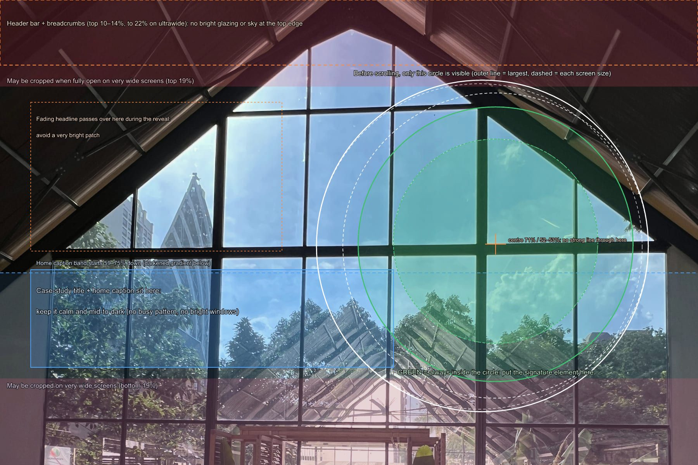
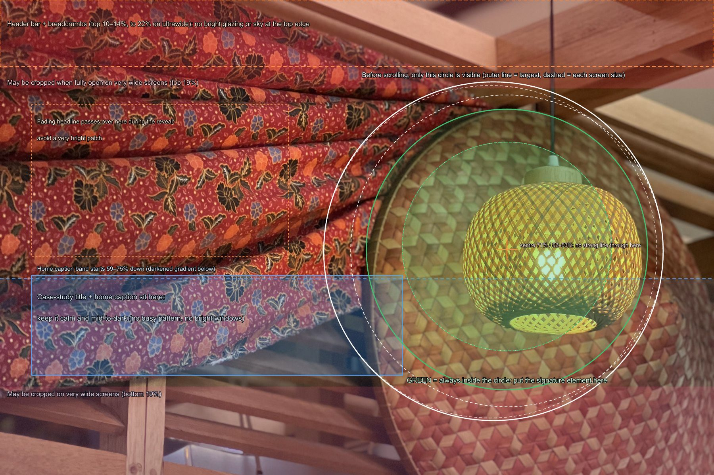

# Rembayung hero: brief for a new visual

What the opening picture of the home page has to do, where everything lands on it, and the file to
deliver. Every position below was measured in the browser at eleven screen sizes, not estimated.
Lay the guides in [hero-guides/](hero-guides/) over a candidate frame to check it.

## Why the current picture underperforms

The current hero is the glazed gable (IMG_3339), shot on the ultra-wide lens on 5 November 2025,
before the restaurant opened.

- **Before scrolling, the circle shows sky.** 60–65% of the circle is sky through glass, with a
  window-bar cross meeting near its centre. It reads as crosshairs on a blue sky, not as an
  interior or a restaurant.
- **It shows the building, not ROUANG's work.** The gable, roof and glazing are the building's
  architecture. The only made object in the full frame is the top of a timber door frame, cut off
  at the bottom edge.
- **The circle's shape disappears on phones.** Dark roof and planters at the edge merge with the
  black page: 20–25% of the circle's edge on desktop and about 42% on phones is too dark to read.
  On phones the thin ring does all the work.
- **The reveal pays nothing off.** The circle opens onto a bigger version of the same window.
- **It is soft on large screens.** The file is 1800 px wide, so on a 1440-wide MacBook it is
  stretched 1.6×, and on a 4K screen 2.1×. Its verticals lean by up to 2.6°.
- **It was taken before opening.** The full portrait has chairs still wrapped in plastic at the
  right edge and two figures by the door. Today's crops happen to leave them out, but a new frame
  should not depend on that.

## The three moments the picture has to work in

### 1. Before scrolling: only a circle is visible

**Desktop (1024 px and wider).** The photograph is shown as a 3:2 landscape, but before the visitor
scrolls, everything outside a circle is black, with the headline on the left.

| | Measured |
| --- | --- |
| Circle centre | **71% across, 52–53% down** (68.7% across on a 1024×768 screen) |
| Circle diameter | **39–47% of the frame's width** (29% on 21:9 ultrawide monitors) |
| Always inside the circle (green on the guide) | centred 71% / 52.5%, radius 19.7% of the width: **x 51–91%, y 23–82%** |
| Inside even on ultrawide (dashed green) | radius 14.7% of the width: **x 56–86%, y 30–74%** |
| On screen | 500–1,000 px across: big enough to read one object, too small for a whole room |

**What goes in it:**
- **One object ROUANG designed, readable at a glance:**
  - a rattan pendant lit inside a woven tray
  - the batik canopy pavilion
  - the slatted timber screen with its batik panels
  - the stained-glass screen with woven trays
- **Mid-tones all the way round the edge.** The edge must stand apart from the black page: at
  least 3:1, which in practice means no large area darker than about RGB 90 (35% grey) touching the
  edge, and no blown windows.
- **Nothing that crosses the centre.** No window bar, post or beam running through 71% / 52%.
- **No sky or glazing inside the circle.** The building's architecture can appear at the edges of
  the full frame only.

**For some visitors the circle is all they ever see.** With reduced motion switched on, or in a
browser without scroll-driven animation, the circle stays closed and never opens.

**Phones and tablets (below 1024 px).** There is no animation. The photo sits in a fixed circle,
300–480 px across, cut from the portrait version. The circle covers the full width and the band
from 7% to 82% of the height (with today's focus setting). Put the subject in the middle of that
band. The focus can move the band: to centre a subject sitting y% down the portrait, the focus is
`50% (4y − 150)%`, which works for subjects 37.5–62.5% down.

**Before the image loads**, the circle is currently plain black. On our side, we will add the
photo's average colour and a tiny blurred preview, so the circle is visible at once. A warm average
reads far better here than the current cold sky blue (#6888a6).

### 2. The reveal: the circle opens into the room

- **How it opens:** as the visitor scrolls, the circle grows and drifts from 71% / 53% to the centre.
- **When the room is fully shown:** the photo covers the whole screen after about **44% of a screen
  height** of scrolling.
- **The headline:** it fades out over the same stretch, crossing the photo's left-centre on its way.

**What this asks of the picture:**
- **Make the reveal explain the teaser.** The circle shows a detail; the full frame shows the room
  that detail belongs to. A pendant becomes the dining hall it hangs over, or a woven tray becomes
  the pavilion. Today the circle teases a window and the reveal shows a bigger window.
- **Lead the eye to the right-centre.** Lines running towards 71% / 52% (tables, beams, a screen)
  make the opening feel like stepping in.
- **No very bright patch in the left-centre** (x 4–40%, y 22–54%), where the headline is still half
  visible during the opening.

### 3. Fully open: the whole picture with its caption

**Home page.**
- **Bottom:** a dark gradient rises from the bottom; its top sits 59–75% down the frame,
  depending on the screen. The caption sits bottom-left ("Rembayung · Restaurant · … · Interior
  design by ROUANG") and "View the project" bottom-right.
- **Top:** the header bar (77 px) returns with a solid dark background whenever the visitor scrolls
  back up. It covers the top 10–14% of the frame on most screens, and down to 22% on 21:9
  ultrawide monitors.

**Case study.** The same file opens the case study full screen.
- **Breadcrumbs:** 9–14% down.
- **Title:** the project name, in large italic, takes the band **58–78% down**, across the left
  half and more.

**Cropping.** The visible rows depend on the screen shape:
- **16:10 to 16:9:** rows 7–93% (13% can go top and bottom on a typical browser window).
- **21:9 ultrawide:** rows 19–81%.

**What this asks of the picture:**
- **A readable room.** Furniture, lighting and finishes, with tables laid.
- **A calm, mid-to-dark lower-left** (x 4–56%, y 58–79%). The title and caption sit on it, so no
  busy batik, slats or bright windows there. The darker it is naturally, the lighter the overlay can
  be, and the more of the photo people actually see. Today the overlays darken the case-study
  opener to an average of 6% brightness.
- **Nothing essential in the top 22% or the bottom 19%,** and nothing bright running into the top
  edge, where the header and breadcrumbs sit.

## The picture itself

**What it shows.**
- **A real photograph of the finished, open restaurant.** No AI-generated or composited interior and
  no AI upscaling. It is labelled "Interior design by ROUANG", so it has to be the built room.
- **ROUANG's work leads.** The batik canopies, rattan pendants, woven trays, slatted screens,
  stained-glass screen, joinery and counters. The building's gable, roof and glazing appear only at
  the edges.
- **Lived in, but not crowded** ("the moment an empty space becomes one that is lived in", brand
  kit p.3):
  - tables laid and lights on
  - no people, or none recognisable
  - not the owner, unless he has agreed in writing
- **Kept out of frame:**
  - crew or installation
  - wrapped furniture
  - point-of-sale terminals
  - table numbers
  - exit signs
  - prices
  - prominent CCTV, speakers or air-conditioning units
  - clutter
- **Retouching:** only temporary things (dust, cables, a stray napkin). Frame permanent fixtures out
  rather than erasing them.

**Light.**
- **Recommended: blue hour,** about 15–30 minutes after sunset (around 7.30 pm in Kuala Lumpur). The
  pendants glow and the windows go deep blue instead of white. It suits the dark site, and the
  circle reads as a lit window.
  - Bracket the exposures (±2 EV) and blend them.
  - Keep the room itself in the mid-tones, so the edge of the circle still reads against the black
    page.
- **Alternative: daylight,** with the camera facing into the room, away from the glazing. Again,
  bracket the exposures. Every wide frame on Drive clips its windows.

**Camera.**
- **Camera height and angle:** level, at 1.2–1.5 m. Not tilted up at the roof, and not from seated
  height.
- **Lens:** 24–35 mm full-frame equivalent. Not the 13 mm ultra-wide (it bends verticals and pushes
  the room away), and not the 77 mm (close-ups with no room around them).
- **Verticals:** perfectly straight, with a tilt-shift lens or corrected afterwards.
- **Sharpness:** tripod, base ISO, f/8–f/11, so the frame is sharp front to back.

**Frames to shoot,** ideally two from the same spot:
- **Landscape 3:2**, with the signature object on the circle position (71% across, 52% down).
- **Portrait 3:4**, with the same object centred, 40–55% down.
- If only one frame is possible, shoot a landscape of at least 6000×4000 with the object at 71%
  across. The portrait is then cut from its right half (46–96% across), which only works if the
  object is no further right than 75%.

## File to deliver

| | Minimum | Ideal |
| --- | --- | --- |
| Landscape 3:2 | 3840 × 2560 | 6000 × 4000 |
| Portrait 3:4 | 1800 × 2400 (narrower switches the case study to its smaller inset layout) | 3000 × 4000 |

- **Format:**
  - JPEG at quality 95 or more, 4:4:4, or a 16-bit TIFF. Flattened, no transparency.
  - Not HEIC: the conversion loses the wide-colour profile, and colour came out 15% weaker.
- **Colour:** sRGB or Display P3, with the profile embedded.
- **Range:** standard range only, no HDR gain maps.
- **Grade lightly.** The site applies the ROUANG grade to every photograph (slightly warm, calmer
  saturation, soft contrast) and strips all metadata, including location.
- **No output sharpening, added grain, heavy noise reduction, vignette, text, logo or frame.**
  Sharpening and grain also make the web files 16–42% heavier, which slows the page.
- **A new file name** (for example `rembayung-hero-2026-11.jpg`). Optimised images are cached for
  31 days, so reusing the old name would keep serving the old picture.

**What the site makes from it:**
- **Landscape files:** up to 3840 px wide, about 160–185 KB at 2560 px and 310 KB at 3840 px.
- **Phone file:** about 33–40 KB at 640 px.
- **Texture cost:** a busy frame (fine rattan or batik everywhere) costs 2–2.8 times the bytes of a
  calm one.
- **Effect on load time:** small, about 0.1 s on a slow phone. On phones the load is dominated by
  fonts and code, not the photograph.

## Checklist before sending

- [ ] A real photograph of the finished restaurant, with nothing generated or composited.
- [ ] One ROUANG-designed object inside the green circle (71% across, 52% down), readable on its own.
- [ ] No window bar, post or beam through the centre of the circle.
- [ ] No sky or glazing in the circle, and no large dark area or blown window on its edge.
- [ ] The full frame shows the room that object belongs to.
- [ ] Lower-left (x 4–56%, y 58–79%) calm and mid-to-dark; top edge not bright.
- [ ] Nothing essential in the top 22% or the bottom 19%.
- [ ] No people recognisable; no crew, wrapped furniture, terminals, table numbers, exit signs or prices.
- [ ] Level camera, 24–35 mm equivalent, verticals straight.
- [ ] Landscape at least 3840 × 2560 (ideally 6000 × 4000), plus a portrait at least 1800 × 2400.
- [ ] JPEG q95+ or 16-bit TIFF, standard range, profile embedded, no sharpening, grain, vignette or text.

## The guides

- **[hero-guide-landscape-6000x4000.png](hero-guides/hero-guide-landscape-6000x4000.png)**
  (transparent). Lay it over a 3:2 frame at any size.
  - **White:** the closed circle at each screen size.
  - **Green:** always visible before scrolling.
  - **Blue:** the title and caption zone.
  - **Orange:** the header band, and where the fading headline passes.
  - **Red:** rows that ultrawide screens crop.
- **[hero-guide-portrait-3000x4000.png](hero-guides/hero-guide-portrait-3000x4000.png)**: the phone
  circle, the phone case-study title zone, and the side strips the phone case study crops away.
- **Previews:**
  - [current hero, landscape](hero-guides/preview-current-hero-landscape.jpg) and [current hero,
    portrait](hero-guides/preview-current-hero-portrait.jpg) show why it underperforms.
  - [IMG_2400](hero-guides/preview-candidate-IMG_2400-landscape.jpg) is the best existing frame.

## Shot reference: an AI mock-up, not for publication

[reference-ai-mockup-NOT-FOR-PUBLICATION.jpg](hero-guides/reference-ai-mockup-NOT-FOR-PUBLICATION.jpg)
is a ChatGPT-generated image, identified by its own Content Credentials (C2PA,
`trainedAlgorithmicMedia`). It is useful as a framing reference for the real photograph, and
must not be used on the site: on the home page it would be captioned "Interior design by ROUANG"
and link to the case study, presenting a generated room as the finished restaurant.

What to copy from it in the real restaurant:
- The camera faces the batik-canopy pavilion, so the stained-glass "Rembayung" name screen, the
  woven trays and a lit pendant fall inside the green circle.
- The dining room opens out to the left, so the reveal explains the teaser.
- The light is blue hour, with the pendants and table lamps lit.

What to improve on it:
- A pavilion post runs down the left side of the circle. Move a step to the right so the post
  clears it.
- Bright window greenery sits where the fading headline passes (left-centre). Shoot a little
  later in the evening, or frame tighter.
- The lower-left is busy with chairs and bright windows. Turn slightly so darker floor and tables
  fill it.

## Until the new picture exists

The best existing frames, from a review of all 101 Rembayung photographs:

- **IMG_2400** (9 Jan 2026, 77 mm): a rattan pendant lit inside a circular woven tray, with red batik
  and a timber frame.
  - **Strengths:** the strongest teaser for the circle, and it echoes the round mark.
  - **Weaknesses:** it is a close-up, so the reveal opens onto no room. Busy batik sits under the
    title, the camera is tilted up about 30°, and the widest 3:2 crop is 3024 px.
- **IMG_2226** (9 Jan 2026, 26 mm): the batik-canopy pavilion with the name screen, stained glass,
  woven trays and bentwood chairs. The strongest whole-interior frame, and the best for the phone
  circle.

Using IMG_2400 on desktop and IMG_2226 on phones would be clearly better than the gable, and both
are unused on the site so far. Neither is the ideal frame described above.

## What happens on our side when the file arrives

1. **Curation:** add the hero entry with its 3:2 and 3:4 crops and focus points.
2. **Export:** let it keep a 3840 px landscape. Today the landscape is cut from the 1800 px-wide
   portrait, so it can never be wider.
3. **Image sizes:** add 2560 and 3840 to the sizes the site serves, so Retina laptops and 4K screens
   get a sharp file.
4. **Loading:** add the colour and blurred preview to the circle.
5. **Check:** re-measure the circle and caption zones, and re-run Lighthouse on the phone home page.
